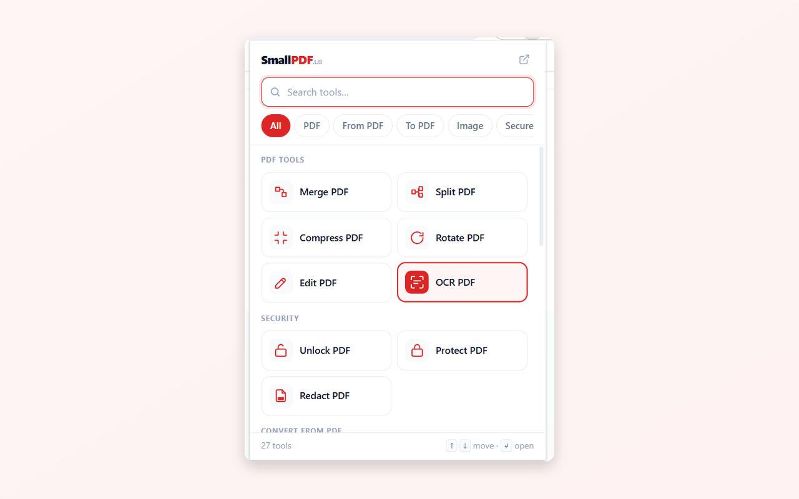

# SmallPDF.us Chrome Extension

A small Chrome extension for **[SmallPDF.us](https://smallpdf.us/)**, a free set of online PDF and image tools. One click from the toolbar opens the tool you need: compress, merge, split, convert, OCR, redact and more.

The extension does not process files itself. Each action opens the matching tool page on [smallpdf.us](https://smallpdf.us/), so you always get the same tools and limits as on the website.

## Features

- **Tool grid** with search and categories (PDF, From PDF, To PDF, Image, Secure). Recently used tools move to the top.
- **Detected on this page:** if the tab you are on is a PDF or an image, the popup suggests the most likely actions first, for example [Compress PDF](https://smallpdf.us/compress-pdf/), [PDF to Word](https://smallpdf.us/pdf-to-word/) and [Split PDF](https://smallpdf.us/split-pdf/).
- **Right-click menu** on a link, an image or the page: SmallPDF.us, then a quick tool.
- **Keyboard friendly:** arrow keys move, <kbd>Enter</kbd> opens, <kbd>Esc</kbd> clears the search.
- **Dark mode** follows your system setting.

## Tools included

[Compress PDF](https://smallpdf.us/compress-pdf/) · [Merge PDF](https://smallpdf.us/merge-pdf/) · [Split PDF](https://smallpdf.us/split-pdf/) · [Rotate PDF](https://smallpdf.us/rotate-pdf/) · [PDF to Word](https://smallpdf.us/pdf-to-word/) · [Word to PDF](https://smallpdf.us/word-to-pdf/) · [PDF to Excel](https://smallpdf.us/pdf-to-excel/) · [PDF to JPG](https://smallpdf.us/pdf-to-jpg/) · [JPG to PDF](https://smallpdf.us/jpg-to-pdf/) · [Compress Image](https://smallpdf.us/compress-image/) · [HEIC to JPG](https://smallpdf.us/heic-to-jpg/) · [OCR PDF](https://smallpdf.us/ocr-pdf/) · [Edit PDF](https://smallpdf.us/edit-pdf/) · [Redact PDF](https://smallpdf.us/redact-pdf/) · [Protect PDF](https://smallpdf.us/protect-pdf/) · [Unlock PDF](https://smallpdf.us/unlock-pdf/) and more.

## Install from source

1. Download or clone this repository.
2. Open `chrome://extensions` in Chrome.
3. Turn on **Developer mode** (top right).
4. Click **Load unpacked** and select this folder.
5. Pin the icon to the toolbar.

## Permissions

| Permission | Why |
|---|---|
| `contextMenus` | the right-click menu |
| `storage` | remember recently used tools |
| `activeTab` | detect whether the current tab is a PDF or an image |
| `https://smallpdf.us/*` | open the tool pages |

The extension has no analytics SDK and sends no data anywhere except by opening smallpdf.us links. Links opened from the extension carry a `utm_source=chrome_extension` parameter so the website can tell where the visit came from.

## Links

- Website: <https://smallpdf.us/>
- Pricing and limits: <https://smallpdf.us/pricing/>
- Privacy policy: <https://smallpdf.us/privacy/>
- Web app source: <https://github.com/mani-django09/smallpdf-us-app>
